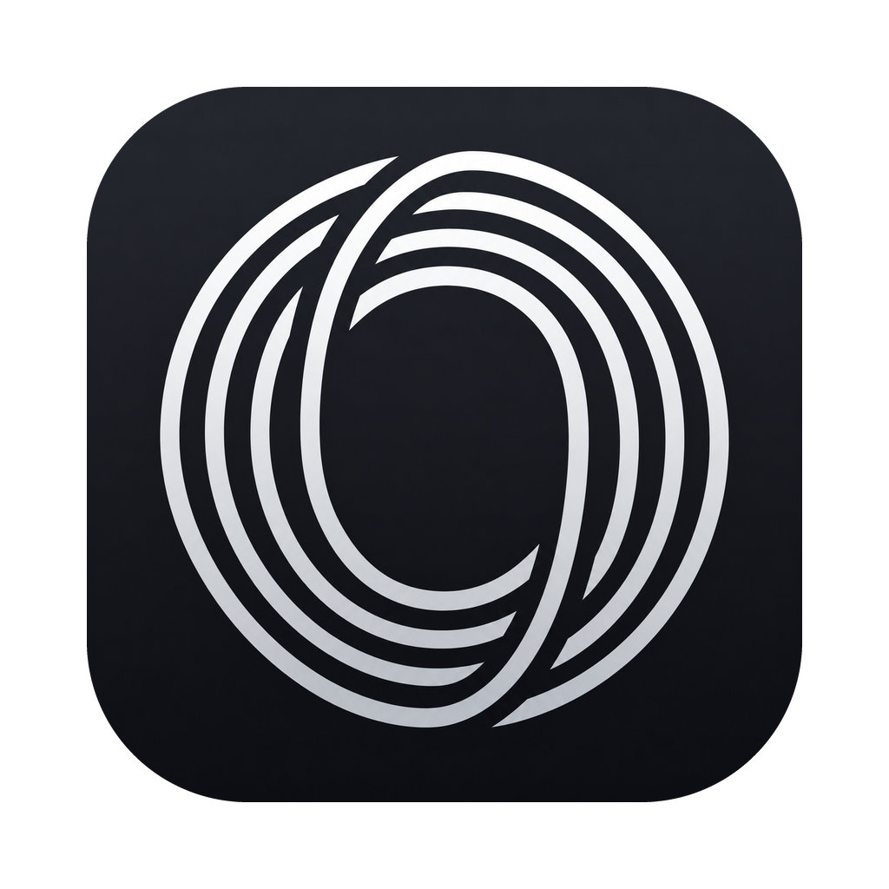
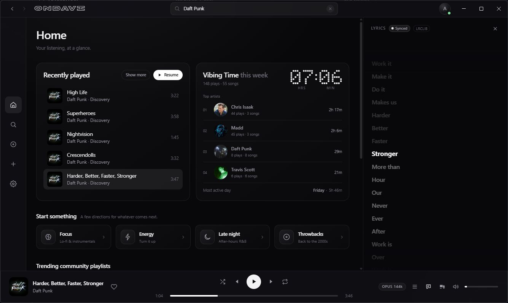
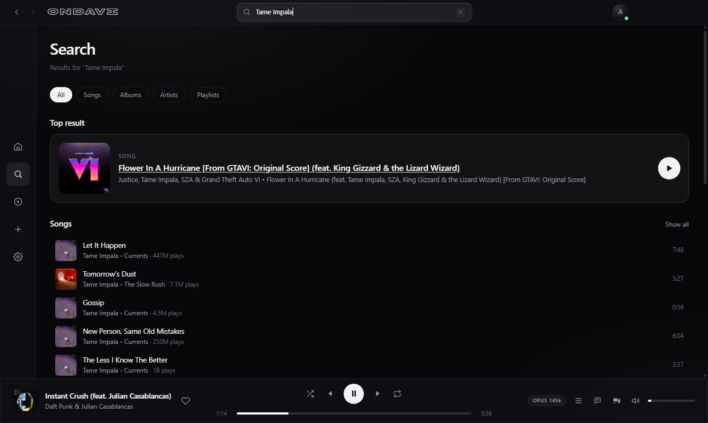
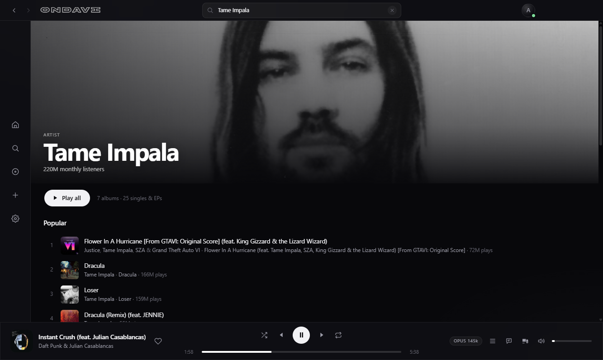
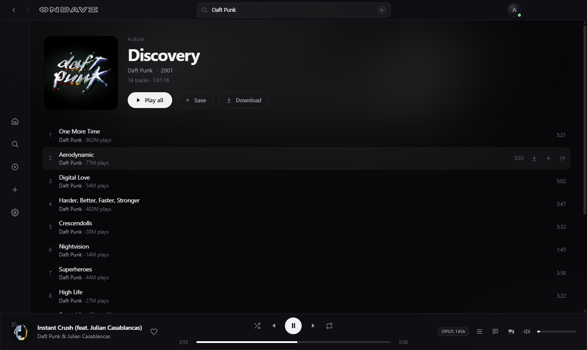
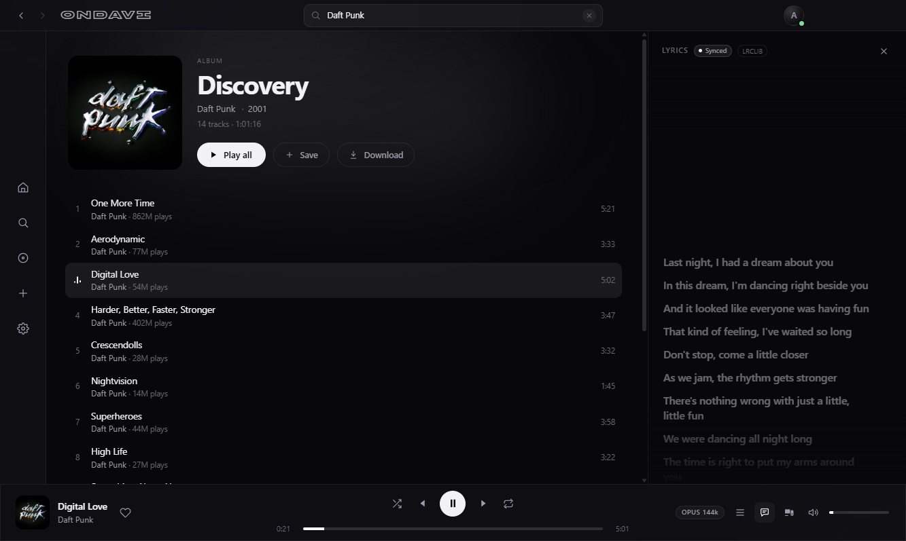

<p align="center">
  
</p>

<h1 align="center">Ondavi</h1>

<p align="center">
  <strong>Music first. Everything else can wait.</strong><br />
  An ad-free desktop music player for macOS and Windows. Local by default,
  with an optional account that keeps your library in step.
</p>

<p align="center">
  <a href="https://github.com/Rei-SU/Viby/releases/latest/download/Viby-macos-arm.dmg"></a>
  <a href="https://github.com/Rei-SU/Viby/releases/latest/download/Viby-macos-intel.dmg"></a>
  <a href="https://github.com/Rei-SU/Viby/releases/latest/download/Viby-windows-x64.exe"></a>
  <a href="https://github.com/Rei-SU/Viby/releases/latest"></a>
  <a href="LICENSE"></a>
</p>

Ondavi opens on your music, not on an offer. No sign-up screen, no ad before the first song, no upsell sitting between you and play. Search for something, press play, and the app gets out of the way.

It plays from YouTube Music's catalogue, so almost anything you look for is there. The player, the library, the lyrics and the downloads are built here — which is why none of them are trying to sell you anything, and why what you keep stays on your machine.

<p align="center">
  
</p>
<p align="center">
  <sub>Home &mdash; mood shortcuts for whatever comes next.</sub>
</p>

## Get Ondavi

Download the latest release with the badges above: **Apple silicon** for an M-series Mac, **Intel** for an older one, **x64** for Windows 10 or 11. Every version and its notes are on the [releases page](https://github.com/Rei-SU/Viby/releases).

**macOS.** Open the disk image and drag the app into Applications. See the [macOS first-launch instructions](CONTRIBUTING.md#releases) if Gatekeeper blocks it.

**Windows.** Run the installer. It installs for your user account without administrator access.

## What it does

- **A player that behaves.** Queue, shuffle, repeat, media keys, resume where you left off, and a cache that makes a replay instant. Quality is either best available or a 64 kbps data saver, and it is never silently downgraded.
- **A queue you can shape.** The queue docks beside the page: reorder it with the grip or the keyboard, or drag any song from search, an album or your history straight into it.
- **A home that remembers.** Recently played rows, the last 100 plays in a side panel, a weekly listening snapshot with your top artists, and mood pages that open YouTube Music's own Focus, Energize, Chill and Decades collections.
- **A library that stays yours.** Liked songs, playlists, saved albums and EPs, history and downloads live on your disk, fully usable signed out. Artist pages open a full discography — Popular releases, Albums, and Singles and EPs — with a Show all page in list or grid. The local copy stays authoritative; an optional account mirrors it across devices.
- **Downloads that belong to the library.** Download songs, albums, playlists or Liked Songs; badges and progress rings show what is on disk, and a docked panel groups active work by album or playlist with pause, resume and cancel. Ondavi follows your connection and can be switched offline by hand, with an Offline Home for what you kept.
- **Lyrics that keep up.** Time-synced lyrics from LRCLIB, plain text from lyrics.ovh as a backup, click any line to seek, and a docked panel that leaves the page usable.
- **Your music on Discord.** Friends see what's playing while the Discord desktop app is running. On by default; pausing clears it, and one switch in Settings turns it off.
- **Optional across devices.** Create an account to keep favourites, playlists, saved albums, history and a few playback settings in step. Ondavi's server stores that mirror encrypted at rest and can read it to merge devices — there is no end-to-end encryption. Signed out, nothing is sent and nothing is required to listen.
- **Your playlists, not a fresh start.** Paste a public Spotify, Apple Music, Deezer, YouTube Music or SoundCloud playlist. Tracks are matched by title, artist and duration; anything uncertain is offered for review, never silently swapped.
- **Actions where you are.** Right-click any song or release for Play next, Add to queue, Add to playlist, Like, Download and Go to artist or album. The menu works from the keyboard and flips at the window edge.
- **Small things that add up.** Search from the titlebar (`⌘K` / `Ctrl K` or `/`), a full set of player shortcuts, launch at login with an optional minimized start, optional close-to-tray playback, Windows taskbar controls, and a What's New sheet after an update.
- **Quiet by design.** A near-monochrome interface with one green active-state accent, a slim icon rail, and a light footprint — under 400 MB at idle in our macOS tests.

## A closer look

<p align="center">
  
  
</p>
<p align="center">
  <sub>Search across songs, albums, artists and playlists &nbsp;·&nbsp; Artist pages with real discographies</sub>
</p>

<p align="center">
  
  
</p>
<p align="center">
  <sub>Daft Punk's Discovery album and track list &nbsp;·&nbsp; Lyrics docked beside Discovery — click a line to jump</sub>
</p>

## What's next

- Manual search for import rows that don't match on their own, plus album and single links in the importer
- Drag-to-reorder playlists and virtualized lists for very long playlists

## Build from source

Requirements: **Node.js 22.12+** (required by Electron 45), npm, and the platform you are building for.

```bash
git clone https://github.com/Rei-SU/Viby.git ondavi
cd ondavi
npm install
npm run runtime   # fetch the pinned playback runtime (once)
npm run dev
```

To build an installer:

```bash
npm run dist:mac   # macOS DMGs — Apple silicon + Intel
npm run dist:win   # Windows x64 installer
```

Packaged builds need no Python install, no configuration file and no first-run setup screen.

## Privacy

No account is required. No analytics, no telemetry, no ad tracking. Your library, playlists, history, downloads and cache live in your user data folder, and the app only talks to the network to browse and search the catalogue, play music, fetch lyrics and artist images, download music, import a link you paste, and check for updates. Discord presence (optional) sends the current song to the Discord app on your computer; Discord shows it according to your own Activity Privacy settings.

Signing in is optional. While signed in, favourites, playlists, saved albums, history and a few playback settings are mirrored to Ondavi's Supabase project so other devices can merge them; the mirror is encrypted at rest and the server can read it — there is no end-to-end encryption. Signing out stops sync and clears the local session; local files stay. Account deletion removes the server copy. Listening never requires an account.

## Contributing

Ondavi is intentionally small and opinionated, and contributions are welcome.

- Open an issue before a large feature or refactor; small fixes can go straight to a PR.
- Keep PRs focused, match the existing Svelte/TypeScript style, and keep the UI monochrome.
- Run `npm run typecheck` and the suites in [TESTING.md](TESTING.md) for the files you changed.
- No ads, paywalls, tracking, telemetry or bundled credentials — ever. Accounts are optional and exist only as a home for backup and sync; they never unlock playback.
- Don't commit `.env` files, cookies, downloaded audio or the vendored runtime.

The full rules live in [CONTRIBUTING.md](CONTRIBUTING.md). Be decent to each other.

## License

Apache-2.0 — see [LICENSE](LICENSE). The Ondavi name and logo are not covered by the license.

<p align="center"><sub>Built with Electron, Svelte and TypeScript. Lyrics by LRCLIB.<br />Ondavi is an independent project, not affiliated with any music service or rights holder.</sub></p>
