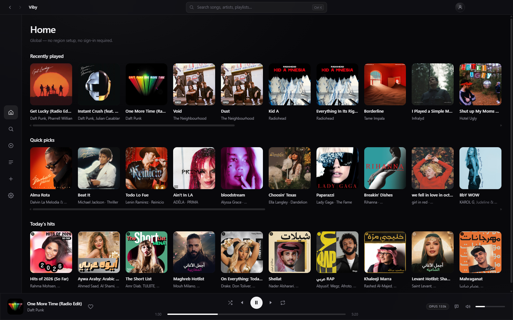
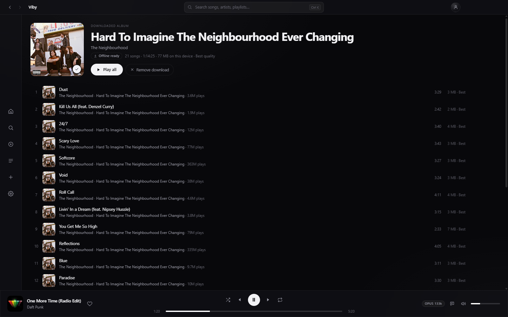

<p align="center">
  
</p>

<h1 align="center">Viby</h1>

<p align="center">
  <strong>Music first. Everything else can wait.</strong><br />
  An ad-free, account-free desktop music player for macOS and Windows.
</p>

<p align="center">
  <a href="https://github.com/Rei-SU/Viby/releases/latest/download/Viby-macos-arm.dmg"></a>
  <a href="https://github.com/Rei-SU/Viby/releases/latest/download/Viby-macos-intel.dmg"></a>
  <a href="https://github.com/Rei-SU/Viby/releases/latest/download/Viby-windows-x64.exe"></a>
  <a href="https://github.com/Rei-SU/Viby/releases/latest"></a>
  <a href="LICENSE"></a>
</p>

Viby opens on your music, not on an offer. No sign-up screen, no ad before the first song, no upsell sitting between you and play. Search for something, press play, and the app gets out of the way.

It plays from YouTube Music's catalogue, so almost anything you look for is there. The player, the library, the lyrics and the downloads are built here — which is why none of them are trying to sell you anything, and why what you keep stays on your machine.

<p align="center">
  
</p>
<p align="center">
  <sub>Home — what you played last, then something new.</sub>
</p>

## Get Viby

Download the latest release with the badges above: **Apple silicon** for an M-series Mac, **Intel** for an older one, **x64** for Windows 10 or 11. Every version and its notes are on the [releases page](https://github.com/Rei-SU/Viby/releases).

The macOS build is unsigned, so the first launch needs **right-click → Open**. After that it opens normally. The Windows installer is per-user and needs no administrator password; updates install in place.

## What it does

- **A player that behaves.** Queue, shuffle, repeat, media keys, resume where you left off, and a cache that makes a replay instant.
- **Background playback, if you want it.** Turn on “Keep playing when closed” and the close button hides Viby in the menu bar or system tray; playback continues until you quit from there.
- **A library that stays yours.** Liked songs, playlists and history on your disk, fully usable signed out. No account, no cloud, no "syncing…" spinner.
- **Offline that means offline.** Download songs, albums, playlists or Liked Songs. The app follows your connection and falls back to what is on the device.
- **Lyrics that keep up.** Time-synced lyrics from LRCLIB, plain text from lyrics.ovh as a backup, click any line to seek, and a docked panel that leaves the page usable.
- **Your playlists, not a fresh start.** Paste a public Spotify, Apple Music, Deezer, YouTube Music or SoundCloud playlist. Tracks are matched by title, artist and duration; anything uncertain is flagged for review, never silently swapped.
- **Quiet by design.** A monochrome interface, a slim icon rail, search from the titlebar (`⌘K` / `Ctrl K`), and a light footprint — under 400 MB at idle in our macOS tests.

## A closer look

<p align="center">
  
  
</p>
<p align="center">
  <sub>Artist pages with real discographies &nbsp;·&nbsp; Album pages with real track lists, artist and year</sub>
</p>

<p align="center">
  
</p>
<p align="center">
  <sub>Lyrics docked beside the page. Click any line to jump to that moment.</sub>
</p>

<p align="center">
  
  
</p>
<p align="center">
  <sub>Search across songs, albums, artists and playlists &nbsp;·&nbsp; Downloads keep their credits and play with the network off</sub>
</p>

## Where it stands

Viby is small on purpose and still early. The version badge at the top always shows the latest release; the [releases page](https://github.com/Rei-SU/Viby/releases) has the notes for each one.

- **macOS builds are unsigned and unnotarized.** Updates download the matching DMG; in-place macOS updates remain deferred until Developer ID signing is available.
- **Windows updates install in place.** Windows 11 is verified on Electron 45. Windows 10 uses the same x64 build and is expected to behave the same; no separate hardware pass is planned.
- **No accounts, no sync, no telemetry.** Your liked songs, playlists and history are local files. Optional, end-to-end encrypted backup and sync is planned, and it will never be required to listen.

## What's next

- Manual search for import rows that don't match on their own, plus album and single links in the importer
- Drag-to-reorder playlists, add-to-playlist from the player bar, virtualized lists for very long playlists
- Optional accounts: private, end-to-end encrypted backup and sync across devices

## Build from source

Requirements: **Node.js 22.12+** (required by Electron 45), npm, and the platform you are building for.

```bash
git clone https://github.com/Rei-SU/Viby.git
cd Viby
npm install
npm run runtime   # fetch the pinned playback runtime (once)
npm run dev
```

To build an installer:

```bash
npm run dist:mac   # macOS DMGs — Apple silicon + Intel
npm run dist:win   # Windows x64 installer
```

Packaged builds need no Python install, no configuration file and no first-run setup screen.

## Privacy

No account is required. No analytics, no telemetry, no ad tracking. Your library, playlists, history, downloads and cache live in your user data folder, and the app only talks to the network to browse, play, fetch lyrics, download music and import a link you paste. If optional accounts ship later, they will only back up and sync your library; listening will never require one.

## Contributing

Viby is intentionally small and opinionated, and contributions are welcome.

- Open an issue before a large feature or refactor; small fixes can go straight to a PR.
- Keep PRs focused, match the existing Svelte/TypeScript style, and keep the UI monochrome.
- Run `npm run typecheck` and the suites in [TESTING.md](TESTING.md) for the files you changed.
- No ads, paywalls, tracking, telemetry or bundled credentials — ever. Accounts, when they ship, will exist only as an optional home for backup and sync.
- Don't commit `.env` files, cookies, downloaded audio or the vendored runtime.

The full rules live in [CONTRIBUTING.md](CONTRIBUTING.md). Be decent to each other.

## License

Apache-2.0 — see [LICENSE](LICENSE). The Viby name and logo are not covered by the license.

<p align="center"><sub>Built with Electron, Svelte and TypeScript. Lyrics by LRCLIB.<br />Viby is an independent project, not affiliated with any music service or rights holder.</sub></p>
