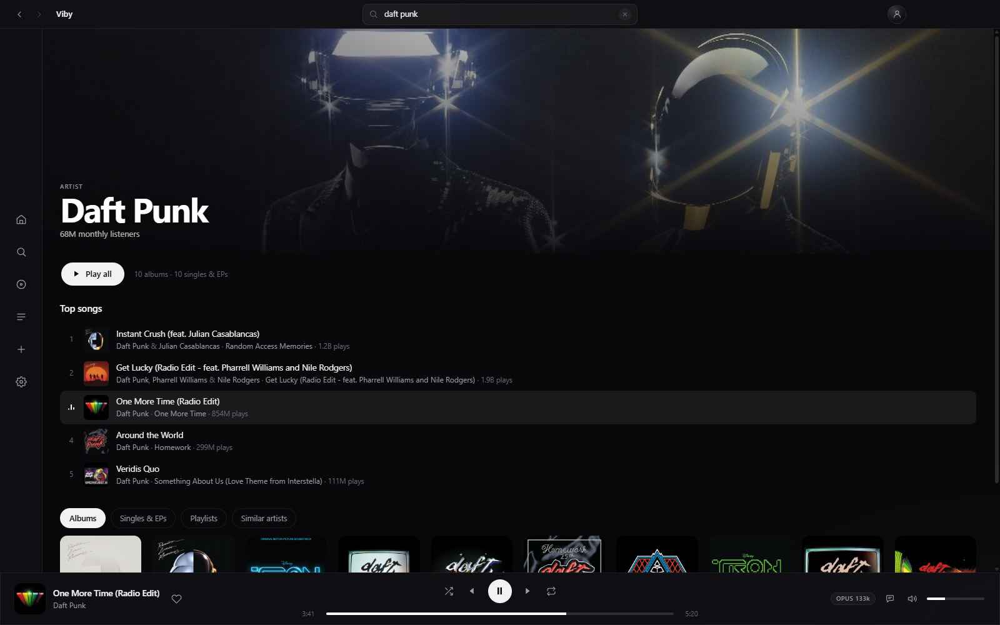
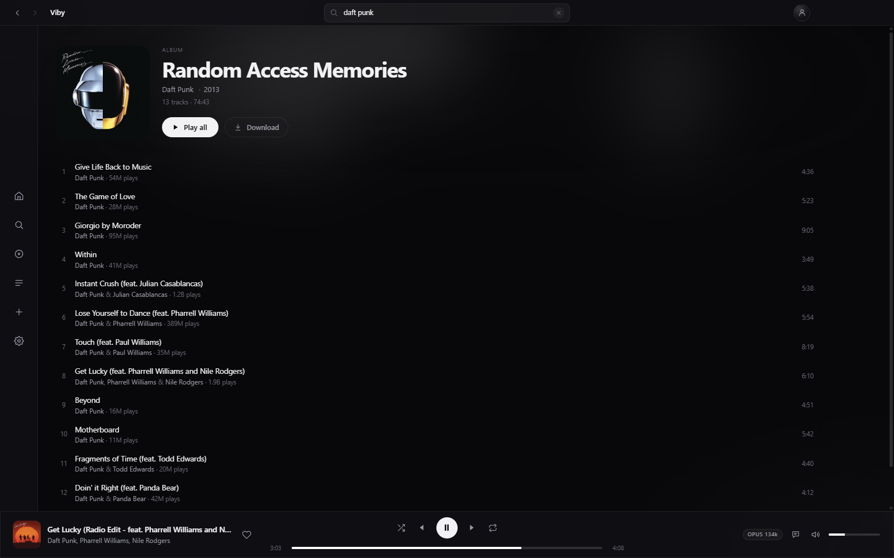
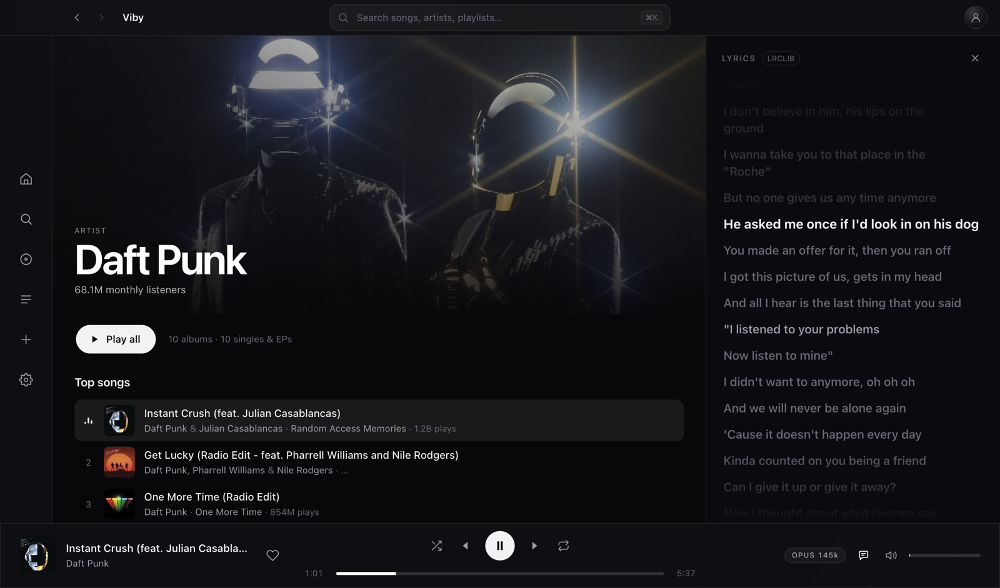
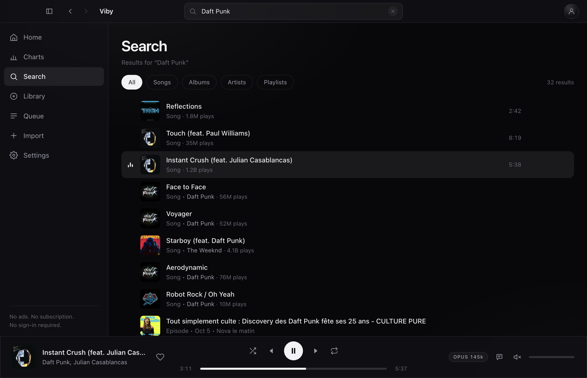
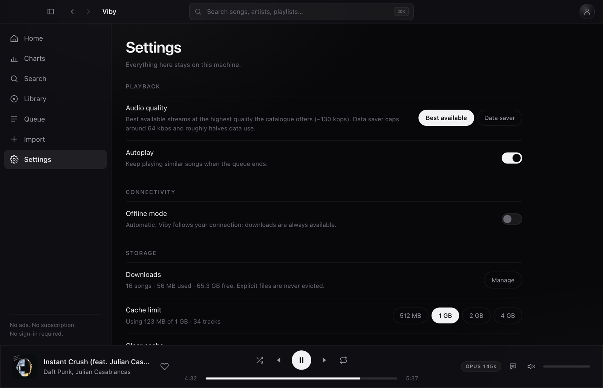

<p align="center">
  
</p>

<h1 align="center">Viby</h1>

<p align="center">
  <strong>Listen without the noise.</strong><br />
  A fast, ad-free desktop music player for macOS and Windows.
</p>

<p align="center">
  
  
  
  
</p>

Viby is a desktop music player for people who just want to press play.

Browse artists, albums and playlists. Build a library that stays yours. Follow along with lyrics that move with the song. Download music for offline listening. No subscription, no ads, nothing to sit through — and no account required.

<p align="center">
  
</p>
<p align="center">
  <sub>Artist pages with full-width artwork, monthly listeners and the full discography.</sub>
</p>

## What's inside

- **A player that behaves.** Queue, shuffle, repeat, media keys, resume where you left off, and a local cache that makes replays instant.
- **A catalogue worth browsing.** Search from the titlebar as you type (`⌘K` / `Ctrl K`), then open the full results page with filters, home shelves, and artist and album pages with real discographies.
- **Lyrics that keep up.** Time-synced lyrics from LRCLIB, with lyrics.ovh as a plain-text fallback, click-to-seek, and a docked sidebar that leaves the page usable.
- **A library that stays yours.** Liked songs, playlists and history stored locally and fully usable signed out. Optional encrypted backup and sync is planned after the beta.
- **Offline when you need it.** Download songs, albums, playlists or Liked Songs and play them without a connection. Search and browsing need the network; your downloads do not.
- **Import from a link.** Paste a public Spotify, Apple Music, Deezer, YouTube Music or SoundCloud playlist. Tracks are matched by title, artist and duration; anything uncertain is flagged for review, never silently swapped.
- **Quiet by design.** A monochrome interface, a slim icon sidebar, a light idle footprint (well under 400 MB in our macOS tests), and a warm start around a second.

## Look around

<p align="center">
  
</p>
<p align="center">
  <sub>Album pages with real track lists, play counts and durations.</sub>
</p>

<p align="center">
  
</p>
<p align="center">
  <sub>Time-synced lyrics docked beside the page; click any line to seek.</sub>
</p>

<p align="center">
  
  
</p>
<p align="center">
  <sub>Search across songs, albums, artists and playlists &nbsp;·&nbsp; Playback, offline mode and storage, all local</sub>
</p>

## Build from source

Requirements: **Node.js 22.12+** (required by Electron 45), npm, and the platform you are building for.

```bash
git clone https://github.com/Rei-SU/Viby.git
cd Viby
npm install
npm run runtime   # fetch the pinned playback runtime (once)
npm run dev
```

To build an installer:

```bash
npm run dist:mac   # macOS DMGs — Apple silicon + Intel
npm run dist:win   # Windows x64 installer
```

Packaged builds need no Python install, no configuration file and no first-run setup screen.

## What's next

Viby is a public beta. The core is in place; the edges are still being sanded.

- Signed and notarized macOS builds (which also enable in-place macOS updates)
- Windows 10 validation on real hardware
- Windows 11 Electron 45 re-check (Electron 37 checks pass, including offline/downloads and in-client updates)
- Manual search for import rows that don't match automatically
- Album and single links in the importer
- Virtualized lists for playlists with thousands of tracks
- Drag-to-reorder playlists
- Add to playlist from the player bar
- Optional accounts with private, end-to-end encrypted backup and sync across devices — planned after the core is fully polished

## Privacy

No account is required, and this beta has no sign-in. No analytics, no telemetry, no ad tracking. Your library, playlists, history, downloads and cache live in your user data folder by default, and the app only talks to the network to browse, play, fetch lyrics, download music and import a link you paste. If optional accounts ship later, they will only back up and sync your library; listening will never require one.

## Contributing

Viby is intentionally small and opinionated, and contributions are welcome.

- Open an issue before a large feature or refactor; small fixes can go straight to a PR.
- Keep PRs focused, match the existing Svelte/TypeScript style, and keep the UI monochrome.
- Run `npm run typecheck` and the suites in [TESTING.md](TESTING.md) for the files you changed.
- No ads, paywalls, tracking, telemetry or bundled credentials — ever. Accounts, when they ship, will exist only as an optional home for backup and sync.
- Don't commit `.env` files, cookies, downloaded audio or the vendored runtime.

The full rules live in [CONTRIBUTING.md](CONTRIBUTING.md). Be decent to each other.

## License

Apache-2.0 — see [LICENSE](LICENSE). The Viby name and logo are not covered by the license.

<p align="center"><sub>Built with Electron, Svelte and TypeScript. Lyrics by LRCLIB.<br />Viby is an independent project, not affiliated with any music service or rights holder.</sub></p>
