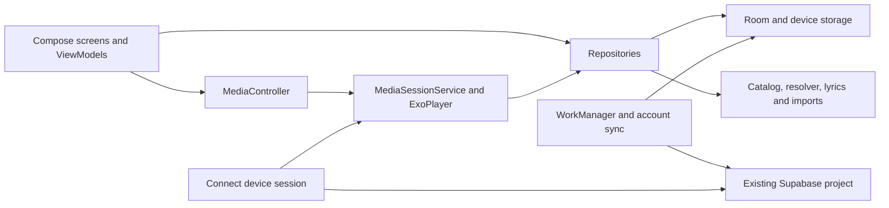

# Ondavi Android architecture

Build Ondavi as a native Kotlin and Jetpack Compose app in `android/`. Media3 owns playback and Android media controls. Room owns the local library and sync outbox. Android shares the desktop account, backend, and track identities. The first public release is a signed GitHub APK, with YouTube Music search, browse, background audio, and offline downloads as release requirements.

The first engineering milestone is a provider spike on real Android devices. Use NewPipe Extractor to evaluate JVM-based resolution in an isolated prototype. Its results determine whether to adopt it under a GPL-compatible distribution plan or evaluate an independently implemented resolver with a compatible license. Start native playback with local files and authorized test streams in parallel so the player can be tested while the provider decision is open.

## Playback prototype

The first implementation lives in a single Gradle module under `android/`. The debug build uses NewPipe Extractor for YouTube Music song search and audio resolution, with requests originating on the device. Tap a result to start playback or open an audio file to test the player independently. The Media3 session owns playback and provides platform media controls. The release build currently exposes local audio only while the resolver remains a debug dependency.

Search results can start a new queue or add a song through **Play next** and **Add to queue**. Tap the mini-player to open Now Playing with artwork, transport controls, shuffle, and repeat. Tap a queue row to play it, or use its menu to remove it. With shuffle off, the menu also moves rows up or down. The local session restores the queue, current song, position, and playback modes without starting audio on a fresh launch.

Install JDK 17 and Android SDK Platform 36, then build and install the debug app on a device with USB debugging enabled.

```sh
cd android
./gradlew :app:assembleDebug :app:lintDebug
./gradlew :app:installDebug
```

For the provider smoke test, search for a song and play it in Best quality. Check seeking, pausing and resuming from the notification, and screen-off playback. Repeat over Wi-Fi and mobile data. In Data Saver, the app reports when the provider offers no format at or below 64 kbps.

For the queue smoke test, start a song, append a second, and insert a third with **Play next**. Confirm the inserted song plays first when the current track ends with the display off. Skip from the system media controls, then check the selected track and queue in Now Playing. Repeat **Play next** with shuffle enabled. Pause at a known position, force-stop the app, and check that the current song, queue, clock, and playback modes restore on launch.

## Local library phase

Home shows recently played songs and a seven-day listening summary. Library opens Liked Songs, Listening History, and user playlists. Song menus add to playlists and the queue. Now Playing and track lists share the same liked state. Playlists support creation, rename, deletion, and track removal and ordering. Liked Songs and playlists can play from any row or start as a shuffled collection.

This phase uses a single atomic local library file through `LocalLibrary`. Reads and writes are serialized off the main thread, and the Compose screens observe the same snapshot as the playback service. Song identity uses a catalog ID or a document URI, independent of its occurrence in the playback queue. The service writes one history entry after 30 seconds of actual playback, including while the activity is closed. Persisted Android document grants allow local audio to remain playable when referenced by a liked song, playlist, or history entry.

For a local smoke test, open an audio document longer than 30 seconds, like it from Now Playing, and add it to a new playlist. Check that the same song appears in Liked Songs, the playlist, and Recently Played. Rename the playlist, force-stop and reopen, then verify the new name, membership, and history. Play from the saved playlist and unlike the song from Now Playing.

## Catalog and playback provider

Desktop uses InnerTube for YouTube Music search, browse, Home, and radio. Its resolver turns a recording ID into playable audio and selects a format. Port the catalog behavior to Kotlin using sanitized desktop response fixtures. Use the resolver spike to establish whether those same recording IDs produce playable audio on Android. Preserve desktop recording identity when selecting an equivalent audio release. [InnerTube client](../src/main/innertube/client.ts) · [Desktop resolver](../src/main/ytdlp/resolver.ts) · [Shared track model](../src/shared/types.ts) · [Recording identity](../src/shared/entity-identity.ts)

| Option | Role in the design |
| --- | --- |
| NewPipe Extractor | First JVM candidate. Test YouTube Music IDs and audio variants on real devices. The library is GPL-3.0-or-later. Resolve the Android distribution license and obligations before integrating it into the release app. Its upstream support for YouTube establishes a starting point for the spike. [Upstream repository and license](https://github.com/TeamNewPipe/NewPipeExtractor#license) |
| Independent JVM resolver | Evaluate if the spike succeeds technically and Android needs to ship under Apache-2.0. Budget ongoing provider maintenance and repeat the same real-device tests. Keep any implementation independent of GPL code. |
| Android yt-dlp wrapper | Technically possible. The upstream wrapper bundles Python and yt-dlp, which conflicts with the Android runtime requirement. [Android wrapper documentation](https://github.com/JunkFood02/youtubedl-android#usage) |
| Official YouTube API and player | The official API policies prohibit separating audio and video and background playback. They also restrict downloading or caching copies and prohibit making content available offline. Sideloading changes distribution and leaves provider rules and permissions applicable. Confirm the proposed release use against the relevant terms and rights before shipping. [YouTube API policies](https://developers.google.com/youtube/terms/developer-policies) · [YouTube Terms](https://www.youtube.com/t/terms) |

Keep the provider boundary small:

```kotlin
interface CatalogSource {
    suspend fun search(query: String, filter: SearchFilter, cursor: String?): CatalogPage
    suspend fun browse(id: String, params: String?, cursor: String?): CatalogPage
    suspend fun home(): HomeCatalog
    suspend fun radio(track: TrackId): CatalogPage
}

interface StreamResolver {
    suspend fun resolve(track: TrackId, quality: AudioQuality): ResolvedAudio
}
```

`ResolvedAudio` carries the URI, MIME and codec information when known, bitrate, optional expiry, and request headers where required. Provider capabilities govern quality modes, cache, and downloads. Keep authorization headers and expiring URLs in memory. Store stable recording IDs in queues, downloads, and synced data. Tag internal IDs with their provider and preserve the existing raw YouTube Music IDs at the desktop wire boundary. Give local files device-local IDs for the first release.

Distinguish unavailable tracks, offline misses, unsupported quality, rate limits, and transient transport failures. Cancel obsolete catalog requests and stale stream resolutions. Coalesce same-track work, respect provider cooldown, and retry once with a fresh resolution on a detected expired stream. An availability or quality failure should be visible in the player. Data Saver should remain an explicit mode. The desktop targets 64 kbps, so the spike must verify which formats can meet that target without silently choosing a higher bitrate or adding a transcoding runtime. [Desktop quality settings](../src/main/settings.ts)

## Android modules and UI



| Gradle module | Ownership |
| --- | --- |
| `:app` | Activity, Compose navigation and features, permissions, share intents, dependency wiring |
| `:core:model` | Pure Kotlin models, provider interfaces, identity matching, sync and Connect wire types |
| `:core:data` | Room, DataStore, catalog, lyrics, imports, account repositories and sync workers |
| `:core:playback` | Media3 service, queue and source resolution, downloads, cache, Connect playback bridge |

Use Gradle Kotlin DSL and a version catalog. Start with a proposed minimum of Android 8.0 (API 26) to limit the first support matrix, and confirm that choice after selecting dependencies. Compile and target against a current stable SDK when scaffolding. Keep screens in `:app` until there is a concrete reason to split them. Compose screens render lifecycle-aware state from ViewModels, with commands flowing back through the repositories and playback controller. [Android app architecture](https://developer.android.com/topic/architecture)

Use bottom navigation for Home, Search, and Library. Keep the mini-player above it. Open a full-screen player with queue and synced lyrics, and put track and release actions in bottom sheets. Settings contains connectivity, quality, downloads, and the optional account. Expose Import from Library and the Android share sheet. Phone and tablet layouts share state and actions. Offline Home shows playable items and recent activity with availability indicators.

## Playback and downloads

A single `MediaSessionService` owns ExoPlayer and the logical queue. Compose connects with a `MediaController`. The session exposes Android notification, lock-screen, Bluetooth, and headset controls. Route all commands through the same queue coordinator and confine player calls to its application looper. Configure audio focus, becoming-noisy handling, and the media playback foreground-service type and permissions. Restore saved playback paused on ordinary app launch, with explicit media resumption through the session. [Media3 background playback](https://developer.android.com/media/media3/session/background-playback) · [Audio focus](https://developer.android.com/media/optimize/audio-focus)

1. A user action creates or updates a queue of stable track references. The coordinator resolves only the selected track and may prefetch one eligible successor on a suitable connection. A new selection invalidates any older resolve before it can change the source.
2. Playback prefers a valid explicit download, then usable cached data, then a provider stream. A partial cache requires network access. A damaged copy can be bypassed once during recovery. Respect the requested quality when reusing cached data.
3. Persist the queue window, index, position, shuffle, and repeat per profile. Save on meaningful transitions and at a bounded cadence while playing. Record a history entry once per play after 30 seconds of actual listening, matching desktop. Derive the visible clock from player events plus a UI ticker that runs only while needed. [Desktop player](../src/renderer/lib/player.svelte.ts) · [Desktop resolver pipeline](../src/main/ipc.ts)

Use Media3's download stack for supported provider media. Keep pinned media and playback cache in separate stores with separate cache keys and eviction rules. Room tracks collection membership, download ownership, and presentation state. The Media3 download index tracks transfer state. Resolve or refresh transient URLs at the transfer boundary. Reconcile both stores after restart so interrupted writes, missing bytes, and completed transfers converge. Deduplicate downloads by recording and selected variant. Cancelling a collection stops its unfinished work and retains completed songs. Remove shared bytes only after their last owner is removed and playback has released them. Support pause, resume, Wi-Fi-only downloads, and progress from a native notification and Library. [Media3 downloading media](https://developer.android.com/media/media3/exoplayer/downloading-media) · [Desktop download manager](../src/main/downloads/manager.ts)

Local files arrive through Android's Storage Access Framework. Retain read access when the document provider grants it, handle revoked access, and offer re-selection. Imported files should play without network or account access. Signed-out mode and manual offline mode remain independent controls. [Android document access](https://developer.android.com/training/data-storage/shared/documents-files)

## Local library and desktop interoperability

Room holds tracks, favourites, releases, playlists and ordered entries, history, playback sessions, account settings, sync versions, conflicts, cursors, and pending edits. Use a signed-out profile and a separate stable profile per account. The first account can adopt the existing local library once, following desktop's behavior. Later accounts start isolated. Downloads, caches, and device preferences are device-scoped. DataStore holds mobile preferences such as download network rules. Use a transactional Room write for any library mutation and its corresponding outbox entry. Switch profile, cancel account work, and clear the player on sign-out or account change. [Android offline-first architecture](https://developer.android.com/topic/architecture/data-layer/offline-first) · [Desktop profile switching](../src/main/account/library-root.ts)

Compose observes local database state. Signed-out sessions use the full local library, with zero calls to the account service. For signed-in sessions, reuse Supabase Auth and Kotlin SDK adapters for authentication, PostgREST, and Realtime. Support email/password, numeric email codes, and recovery. Protect the persisted session with an Android Keystore-backed encryption key, exclude credentials and session ciphertext from Android backup, and keep secrets out of logs. If link-based auth is introduced, use a verified HTTPS Android App Link and PKCE. Keep a recovery session out of sync and Connect until the password is updated. Reuse account deletion and export semantics. [Desktop auth](../src/main/account/auth.ts) · [Supabase Kotlin OTP](https://supabase.com/docs/reference/kotlin/auth-verifyotp) · [Android Keystore](https://developer.android.com/privacy-and-security/keystore) · [Android App Links](https://developer.android.com/training/app-links)

Use the existing `sync_records` read path and authenticated `sync_push` RPC. The desktop wire format defines kinds `favorite`, `playlist`, `playlist_track`, `album`, `history`, and `setting`. Preserve record IDs, payload shape, epoch-millisecond timestamps, playlist entry positions, and the desktop settings allowlist. Use Kotlin `Long` for revisions and timestamps. Apply the same `(updated_at, device_id, deleted)` ordering, with UUID string tie-breaking and tombstone precedence on a matching timestamp and device. Preserve `discordPresence` as a desktop setting without exposing a mobile Discord toggle. Leave device-only items and local file references out of the outbox. [Desktop record mapping](../src/main/account/records.ts) · [Comparator](../src/main/account/compare.ts) · [RPC migration](../supabase/migrations/20261127043901_harden_sync_writes.sql) · [Kotlin RPC](https://supabase.com/docs/reference/kotlin/rpc)

Pull before pushing. Page by ascending server revision and commit each page's applied changes and cursor together. Push in bounded batches. Acknowledge only unchanged outbox entries the server accepted, use returned timestamps, and reconcile rejected entries by exact record key. Keep new-install defaults out of the initial upload. History cap evictions stay local. The server prunes tombstones after 90 days, so include long-offline device recovery in the desktop and Android compatibility test and resolve any resurrection issue on the shared contract. Schedule account-scoped unique work on local edits, and trigger foreground sync on launch, reconnect, and user request. Use WorkManager for constrained background retry. Keep the server behind its existing RLS and use only a publishable or existing anon client key in the APK. [Desktop sync](../src/main/account/sync.ts) · [Tombstone pruning](../supabase/migrations/20261126231617_prune_sync_tombstones.sql) · [WorkManager](https://developer.android.com/develop/background-work/background-tasks/persistent)

## Connect, lyrics, and imports

Join the existing private `account:<userId>:devices` channel while signed in and the UI or playback service is active. Disconnect when idle, signed out, in recovery, or switched to another account. Reuse the `device` broadcast event, command envelopes, presence throttles, and claim ordering. Use a stable install UUID and display platform `Android`. Adapt Media3's millisecond positions to desktop's seconds at the wire boundary. Use a monotonic local clock for extrapolation and epoch time for wire timestamps. Reject stale, duplicate, and mismatched commands. Preserve the desktop handoff rule. The receiver claims after actual playback starts, so a failed resolve leaves the source playing. Idle remote starts are subject to Android's foreground execution and audio-focus rules. [Connect wire types](../src/shared/connect.ts) · [Desktop channel](../src/main/connect/supabase-channel.ts) · [Handoff behavior](../src/renderer/lib/connect.svelte.ts) · [Realtime authorization](https://supabase.com/docs/guides/realtime/authorization)

Use LRCLIB with lyrics.ovh fallback, cache results locally, and reuse desktop lyric alignment and recording-match fixtures. Active lyrics follow the local or mirrored playhead and expose tap-to-seek. Port playlist link detection, adapters, and conservative matching behind an import repository. Keep imported order and separate automatic matches from entries that need review. Bound response sizes and timeouts, validate HTTP redirects, and require a user action to create the playlist. [Desktop lyrics](../src/main/lyrics.ts) · [Import research](import-research.md)

## Implementation and release

| Milestone | Exit criteria |
| --- | --- |
| 1. Provider and device spike | Prepare and seek representative YouTube Music tracks in ExoPlayer on physical Android devices over Wi-Fi and mobile data. Confirm search and browse IDs resolve, test audio variants and Data Saver, exercise expiry and rate limiting, and verify offline playback on a provider-authorized download. Record provider failure classes and startup times. Choose the dependency and release licensing approach. |
| 2. Native player and library | Compose Home, Search, Library, and Now Playing can use the real catalog and play music. Lock screen, headset controls, queue operations, process-death resume, and signed-out use pass on hardware. Room stores likes, playlists, releases, and history. |
| 3. Offline and desktop compatibility | Downloads survive restart and play in airplane mode. Auth and two-way library sync work with desktop 0.7.0 against a test project. Cover account boundaries, concurrent edits, clocks, conflicts, and first-device adoption. Verify Connect control and successful and failed handoffs in both directions. Verify lyrics and playlist import with realistic fixtures. |
| 4. Signed GitHub release | Run JVM, emulator, and physical-device tests. Publish a release APK only after the provider parity and distribution decisions are resolved. Install the signed artifact on a clean device and upgrade it over a previous signed build with an existing library and downloads. |

Maintain sanitized contract fixtures that both TypeScript and Kotlin can read. Cover ID and unit conversions, playlist order, conflict ordering, malformed payloads, and Connect messages. Run deterministic JVM and Android tests in CI, including Room migrations and Compose flows. Run live provider smoke tests separately on real hardware and record results when a provider changes. Include network switching, expired URLs, screen-off playback, notifications, Bluetooth disconnect, data saver, process death, disk pressure, download cancellation, and revoked document access in the device matrix.

Use a stable Android application ID and signing identity, increasing version codes and a release-only signing workflow with the key outside the repository. Publish the signed APK and SHA-256 checksum in GitHub Releases. Keep Android checks and publishing separate from the desktop release workflow so either platform can release independently. [Android app signing](https://developer.android.com/studio/publish/app-signing)
